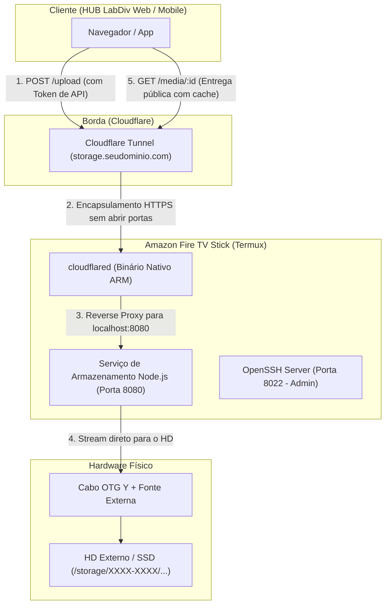

# Guia de Configuração e Provisionamento: Servidor de Armazenamento no Fire TV Stick (Termux)
**Status:** ATIVO  
**Revisão:** V2.1 - Portal Web Independente (Portfólio + Cofre Pessoal + Console HUB) & Dual-Write Híbrido  
**Ambiente:** Amazon Fire TV Stick | Termux (Android Userland) | Arquitetura ARM (armv7l ou aarch64)  

---

## 1. Desafios e Premissas de Engenharia do Fire TV Stick

Transformar um Fire TV Stick em um servidor de mídia doméstico é uma excelente solução de baixo consumo elétrico (~2W a 5W), mas impõe restrições de arquitetura muito específicas que diferem radicalmente de um servidor Linux tradicional:

| Desafio no Fire OS | Consequência | Solução Adotada |
| :--- | :--- | :--- |
| **Sem Docker nativo** | O kernel do Android não possui suporte completo a cgroups/namespaces. | Binários nativos para ARM ou runtime ultraleve (Node.js nativo via `pkg`). |
| **RAM Reduzida (1GB - 1.5GB)** | O *Low Memory Killer (LMK)* do Android encerra processos pesados em background. | Substituição de stacks pesadas por um serviço de upload enxuto (~25MB de RAM). |
| **Portas Privilegiadas (<1024)** | Usuários comuns no Android não podem abrir portas 22, 80 ou 443 sem root. | OpenSSH na porta `8022` e API de Storage na porta `8080`. |
| **Alimentação do HD (OTG)** | A porta micro-USB do Fire Stick não fornece amperagem suficiente para girar um HD externo. | **Obrigatório usar cabo OTG em "Y" com hub USB e fonte externa** para o HD. |
| **Permissões do Android (SAF)** | A partir do Android 10/11, escrita em HD externo é bloqueada fora da pasta do app. | Gravação no diretório com permissão de escrita concedida pelo Android (`Android/data/com.termux/files`). |
| **Suspensão Agressiva de CPU** | O Fire OS coloca a CPU em *Deep Sleep* quando a TV desliga. | Bloqueio de suspensão via `termux-wake-lock` e flags do ADB. |

---

## 2. Diagrama de Arquitetura da Solução



---

## 3. Fase 1: Blindagem contra o Deep Sleep e Inicialização Automática

O Fire OS encerra processos em segundo plano agressivamente se não for configurado.

### 1.1 Impedir o Android de Matar o Termux (Wakelock)
Dentro da sessão do Termux:
```bash
termux-wake-lock
```
*Isso garante que o processador continue acordado mesmo que a TV entre em standby.*

### 1.2 Configurações de Segundo Plano via ADB (Recomendado)
Conecte via `adb` do seu computador no IP do Fire Stick (com a "Depuração ADB" ativada nas Opções de Desenvolvedor da TV):
```bash
adb connect IP_DO_FIRE_STICK:5555

# Colocar o Termux na whitelist do Doze Mode (economia de bateria)
adb shell dumpsys deviceidle whitelist +com.termux

# Desativar o timeout de sleep do Fire OS
adb shell settings put global sleep_timeout 0
```

### 1.3 Instalação de Ferramentas Essenciais no Termux
Atualize a árvore de pacotes do Termux:
```bash
pkg update && pkg upgrade -y
pkg install -y openssh curl wget git nodejs-lts jq
```

---

## 4. Fase 2: Configuração do SSH no Termux

O OpenSSH no Termux opera como usuário não-root e escuta na porta **`8022`**.

### 2.1 Configurar Chave Pública SSH
Para segurança estrita sem login por senha:
1. No seu computador de desenvolvimento:
   ```bash
   # Exiba sua chave pública
   cat ~/.ssh/id_ed25519.pub
   ```
2. No Termux (Fire Stick):
   ```bash
   mkdir -p ~/.ssh
   chmod 700 ~/.ssh
   # Cole sua chave pública dentro do arquivo:
   nano ~/.ssh/authorized_keys
   chmod 600 ~/.ssh/authorized_keys
   ```

### 2.2 Configurar o Daemon SSH (`sshd`)
Edite a configuração do SSH no Termux:
```bash
nano $PREFIX/etc/ssh/sshd_config
```
Adicione ou descomente:
```ini
Port 8022
PasswordAuthentication no
PubkeyAuthentication yes
AuthorizedKeysFile .ssh/authorized_keys
```

### 2.3 Inicializar e Testar o SSH
Inicie o servidor SSH:
```bash
sshd
```
*Dica: Para descobrir seu usuário do Termux, rode `whoami` (geralmente algo como `u0_aXXXX`).*

Para conectar a partir da sua máquina de trabalho:
```bash
ssh -p 8022 u0_aXXXX@IP_DO_FIRE_STICK
```

---

## 5. Fase 3: Conexão do HD Externo via OTG

Para ligar um HD ou SSD no Fire Stick, você precisa de um **Cabo OTG Micro-USB em Y**.
> [!IMPORTANT]
> **Alimentação Elétrica:** A porta micro-USB do Fire Stick entrega apenas ~0.5A. Se você plugar um HD mecânico sem alimentação externa, o Fire Stick vai reiniciar em loop (*brownout*). Conecte uma fonte de alimentação dedicada de 5V 2A+ na perna de energia do cabo OTG ou use um HD externo com fonte própria.

### 3.1 Identificar o HD no Termux
1. Conceda permissão de armazenamento ao Termux:
   ```bash
   termux-setup-storage
   ```
   *(Aparecerá um popup na tela da TV pedindo permissão de leitura/gravação; clique em Permitir).*

2. Descubra o caminho de montagem do HD:
   ```bash
   ls -la /storage/
   ```
   Você verá o diretório do armazenamento interno (`emulated` ou `self`) e uma pasta com formato hexadecimal, por exemplo: `/storage/1234-ABCD/`.

### 3.2 O Diretório Seguro de Escrita
No Android unrooted, a gravação só é garantida sem restrições do sistema dentro da pasta dedicada do app:
```bash
# Crie a pasta no HD (substitua 1234-ABCD pelo ID do seu HD)
export HD_PATH="/storage/1234-ABCD/Android/data/com.termux/files/hub_data"
mkdir -p "$HD_PATH/media"
mkdir -p "$HD_PATH/documents"

# Crie um atalho na home do Termux para facilitar
ln -s "$HD_PATH" ~/hub_storage
```

---

## 6. Fase 4: O Serviço de Storage Ultraleve (Node.js)

Em vez de tentar rodar o MinIO (que consumiria 200MB+ de RAM e exigiria configurações complexas no Android), criaremos um **Microserviço REST nativo em Node.js com apenas ~25MB de RAM**.

Ele proverá:
1. Endpoint `POST /api/upload`: Protegido por um Token Secreto (`x-storage-key`). Salva com nomes UUIDv4 para impedir colisões e ataques de *path traversal*.
2. Endpoint `GET /media/:filename`: Servidor estático com headers de cache agressivo (`Cache-Control: public, max-age=31536000, immutable`).
3. Endpoint `DELETE /api/media/:filename`: Para a funcionalidade de limpeza de órfãos do HUB.

### 6.1 Criar o Projeto no Termux
```bash
mkdir -p ~/hub-storage-server
cd ~/hub-storage-server
npm init -y
npm install express multer cors dotenv
```

### 6.2 Gerar Token Secreto de Autenticação
```bash
node -e "console.log(require('crypto').randomBytes(24).toString('hex'))"
```
Copie a chave gerada.

### 6.3 Arquivo `.env` do Servidor
```bash
nano ~/hub-storage-server/.env
```
```ini
PORT=8080
STORAGE_DIR=/storage/1234-ABCD/Android/data/com.termux/files/hub_data
API_SECRET_KEY=SUA_CHAVE_SECRETA_GERADA_AQUI
```

### 6.4 Código do Servidor (`server.js`)
```bash
nano ~/hub-storage-server/server.js
```
```javascript
const express = require('express');
const multer = require('multer');
const path = require('path');
const fs = require('fs');
const cors = require('cors');
require('dotenv').config();

const app = express();
const PORT = process.env.PORT || 8080;
const STORAGE_DIR = process.env.STORAGE_DIR || path.join(__dirname, 'storage');
const SECRET_KEY = process.env.API_SECRET_KEY;

// Garantir diretórios
const MEDIA_DIR = path.join(STORAGE_DIR, 'media');
if (!fs.existsSync(MEDIA_DIR)) {
  fs.mkdirSync(MEDIA_DIR, { recursive: true });
}

app.use(cors());
app.use(express.json());

// Middleware de Autenticação para ações administrativas/upload
function requireAuth(req, res, next) {
  const token = req.headers['x-storage-key'] || req.query.key;
  if (!token || token !== SECRET_KEY) {
    return res.status(401).json({ error: 'Acesso não autorizado: chave de API inválida.' });
  }
  next();
}

// Configuração do Multer (Stream direto para o HD)
const storage = multer.diskStorage({
  destination: (req, file, cb) => cb(null, MEDIA_DIR),
  filename: (req, file, cb) => {
    const ext = path.extname(file.originalname).toLowerCase();
    const safeName = `${Date.now()}-${Math.random().toString(36).substring(2, 10)}${ext}`;
    cb(null, safeName);
  }
});

const upload = multer({
  storage,
  limits: { fileSize: 50 * 1024 * 1024 } // Limite de 50MB
});

// 1. Healthcheck
app.get('/health', (req, res) => {
  res.json({ status: 'ok', uptime: process.uptime(), device: 'FireTV-Termux' });
});

// 2. Upload de Arquivo
app.post('/api/upload', requireAuth, upload.single('file'), (req, res) => {
  if (!req.file) {
    return res.status(400).json({ error: 'Nenhum arquivo enviado.' });
  }

  const fileUrl = `/media/${req.file.filename}`;
  res.status(201).json({
    success: true,
    filename: req.file.filename,
    url: fileUrl,
    size: req.file.size,
    mimetype: req.file.mimetype
  });
});

// 3. Entrega Estática de Arquivos com Cache Agressivo (Substituição de CDN)
app.use('/media', (req, res, next) => {
  res.setHeader('Cache-Control', 'public, max-age=31536000, immutable');
  res.setHeader('X-Content-Type-Options', 'nosniff');
  next();
}, express.static(MEDIA_DIR));

// 4. Exclusão de Arquivo (Limpeza de Órfãos)
app.delete('/api/media/:filename', requireAuth, (req, res) => {
  const filename = path.basename(req.params.filename);
  const targetPath = path.join(MEDIA_DIR, filename);

  if (fs.existsSync(targetPath)) {
    fs.unlinkSync(targetPath);
    return res.json({ success: true, message: 'Arquivo removido com sucesso.' });
  }
  res.status(404).json({ error: 'Arquivo não encontrado.' });
});

app.listen(PORT, '127.0.0.1', () => {
  console.log(`[HUB Storage] Rodando em http://127.0.0.1:${PORT}`);
});
```

---

## 7. Fase 5: Exposição Externa com Cloudflare Tunnel (ARM)

O binário do `cloudflared` funciona perfeitamente no Termux sem precisar abrir portas no roteador de casa.

### 5.1 Baixar o Binário ARM Oficial
Descubra a arquitetura da CPU do seu Fire Stick:
```bash
uname -m
```
* Se for `armv7l` (Fire Stick Lite / Basic / 3rd Gen): Baixe a versão `arm`.
* Se for `aarch64` (Fire Stick 4K / 4K Max): Baixe a versão `arm64`.

Exemplo para `armv7l`:
```bash
wget https://github.com/cloudflare/cloudflared/releases/latest/download/cloudflared-linux-arm -O $PREFIX/bin/cloudflared
chmod +x $PREFIX/bin/cloudflared
```
*(Para `aarch64`, use `cloudflared-linux-arm64` no link).*

### 5.2 Autenticar e Criar o Túnel
```bash
cloudflared tunnel login
```
*Abra o link gerado no navegador do seu computador e autorize o seu domínio.*

Crie o túnel:
```bash
cloudflared tunnel create firestick-storage
```
*Copie o UUID gerado.*

### 5.3 Configurar o `config.yml` do Túnel
```bash
mkdir -p ~/.cloudflared
nano ~/.cloudflared/config.yml
```
```yaml
tunnel: SEU-TUNNEL-UUID-AQUI
credentials-file: /data/data/com.termux/files/home/.cloudflared/SEU-TUNNEL-UUID-AQUI.json

ingress:
  # Roteia o tráfego do subdomínio para a API Node.js local
  - hostname: storage.seudominio.com.br
    service: http://127.0.0.1:8080
    originRequest:
      connectTimeout: 30s

  - service: http_status:404
```

Associe o DNS:
```bash
cloudflared tunnel route dns firestick-storage storage.seudominio.com.br
```

---

## 8. Fase 6: Inicialização Automática e Daemon (Termux:Boot)

Como o Android não possui `systemd`, utilizamos um script gerenciador ou o aplicativo complementar **Termux:Boot**.

### 8.1 Criar o Script Mestre de Execução
Crie o script `~/start_services.sh`:
```bash
nano ~/start_services.sh
```
```bash
#!/data/data/com.termux/files/usr/bin/bash

echo "[*] Mantendo wakelock ativo..."
termux-wake-lock

echo "[*] Iniciando OpenSSH na porta 8022..."
sshd

echo "[*] Iniciando Servidor de Storage (Node.js)..."
cd /data/data/com.termux/files/home/hub-storage-server
nohup node server.js >> server.log 2>&1 &

echo "[*] Iniciando Cloudflare Tunnel..."
nohup cloudflared tunnel run firestick-storage >> tunnel.log 2>&1 &

echo "[+] Todos os serviços iniciados com sucesso!"
```
Dê permissão de execução:
```bash
chmod +x ~/start_services.sh
```

### 8.2 Inicialização com o Boot da TV (Termux:Boot)
Se instalar o app **Termux:Boot** (disponível no F-Droid):
```bash
mkdir -p ~/.termux/boot
ln -s ~/start_services.sh ~/.termux/boot/start_services.sh
```
*Assim, sempre que o Fire Stick ligar na tomada, os serviços iniciarão sozinhos.*

---

## 9. Checklist de Testes de Homologação

Execute estes testes a partir do seu computador para validar antes de mexer no código do HUB:

| Teste | Comando / Ação | Resultado Esperado |
| :--- | :--- | :--- |
| **1. SSH** | `ssh -p 8022 u0_aXXXX@IP_DO_STICK` | Login direto com chave Ed25519 |
| **2. Healthcheck Público** | `curl https://storage.seudominio.com.br/health` | `{"status":"ok","device":"FireTV-Termux"}` |
| **3. Upload via POST** | `curl -X POST -H "x-storage-key: SUA_CHAVE" -F "file=@foto.jpg" https://storage.seudominio.com.br/api/upload` | Retorna URL gerada (`/media/123...jpg`) |
| **4. Download Público** | Acessar a URL retornada no navegador | Retorno direto da foto com HTTPS |
| **5. Validação no HD** | No Termux: `ls -lh ~/hub_storage/media/` | Arquivo físico gravado no HD externo |

---

## 10. Adaptação no Código do HUB LabDiv

Após a homologação do Fire Stick, o HUB LabDiv precisará apenas das seguintes variáveis no `.env.local`:

```ini
NEXT_PUBLIC_STORAGE_BASE_URL="https://storage.seudominio.com.br"
STORAGE_SERVER_KEY="SUA_CHAVE_SECRETA_GERADA_AQUI"
```

E no código do HUB (arquitetura **Dual-Write + Failover Híbrido**):
1. `src/lib/proxy.ts` e `next.config.ts`: Permitir `https://storage.hublabdiv.com.br` no CSP e otimizador de imagens.
2. `src/lib/firestick-storage.ts`, `src/app/actions/media.ts` e `src/app/actions/submissions.ts`: Gravação paralela no Cloudinary (primário) + Fire Stick (`backup_url` via `/api/upload` com `x-storage-key`) e fallback automático no front-end (`MediaCard.tsx` / `CommentsSection.tsx`).

---

## 11. Evolução v2.0: Portal Web Independente (`firestick-portal/`)

O código-fonte completo do portal web independente reside fora da árvore Next.js do HUB, em `../firestick-portal/` (`server.js`, `public/index.html`, `public/styles.css`, `public/app.js` e `deploy-firestick.sh`), com identidade visual própria **Dourado & Roxo** (*Obsidian Violet & Liquid Gold*).

### 11.1 Isolamento Físico em 3 Zonas no HD Externo + Cache Interno `ext4`

| Zona / Caminho | Visibilidade | Finalidade | Otimização Android / Termux |
| :--- | :--- | :--- | :--- |
| `~/hub-storage-server/data/catalog.json` | Interna (`ext4`) | Índice primário do Portfólio em RAM + flash interna rápida | Responde `GET /api/portfolio` em `< 2ms` sem acordar o HD mecânico USB. |
| `STORAGE_DIR/portfolio/` (`originals/`, `thumbs/`, `catalog.json`) | Pública (`/`) | Galeria do Portfólio Fotográfico + Cinema Lightbox 60fps | Miniaturas WebP (`800px`) e EXIF gerados no navegador do cliente (0% CPU no Stick). Espelhamento assíncrono via `fs.promises.writeFile` (sem `renameSync` no FUSE/exFAT). |
| `STORAGE_DIR/vault/` | Privada (Admin) | **Cofre Pessoal** (Drive privado com subpastas para PDFs, vídeos, ZIPs, docs) | Streaming nativo com `HTTP 206 Partial Content` (`Range`, chunks de `64 KB`) sem estourar os ~1 GB de RAM. |
| `STORAGE_DIR/media/` | API HUB + Console Admin | Armazenamento dedicado exclusivamente às mídias do **HUB LabDiv** | 100% retrocompatível com `GET /health`, `POST /api/upload`, `GET /media/:filename` e `DELETE /api/media/:filename`. |

### 11.2 Variáveis Adicionais no `.env` do Fire Stick (`~/hub-storage-server/.env`)

```ini
PORT=8080
BIND_HOST=127.0.0.1
STORAGE_DIR=/storage/XXXX-XXXX/Android/data/com.termux/files/hub_data
INTERNAL_DATA_DIR=/data/data/com.termux/files/home/hub-storage-server/data
API_SECRET_KEY=SUA_CHAVE_SECRETA_DO_HUB_AQUI
ADMIN_PASSWORD=SUA_SENHA_DO_CONSOLE_WEB_ADMIN
SESSION_SECRET=SEGREDO_HMAC_64_HEX_GERADO_AUTOMATICAMENTE
PORTFOLIO_TITLE=JOÃO PAULO STANGORLINI — PORTFOLIO
```

### 11.3 Deploy Cirúrgico via SSH (`deploy-firestick.sh`)

O script `firestick-portal/deploy-firestick.sh` atualiza `package.json`, `server.js` e `public/` em **uma única sessão SSH** (`tar` via pipe), preservando integralmente `.env`, `run_tunnel.sh` (`proot` + `cloudflared`) e `~/.termux/boot/01-server.sh`, e reiniciando exclusivamente o processo `node server.js`:

```bash
cd "../firestick-portal"

# Deploy padrão (mantém ADMIN_PASSWORD atual ou gera uma nova no primeiro deploy v2):
./deploy-firestick.sh

# Ou definindo explicitamente a senha do botão "Console / Admin":
NEW_ADMIN_PASSWORD="SuaSenhaForteAqui" ./deploy-firestick.sh
```
