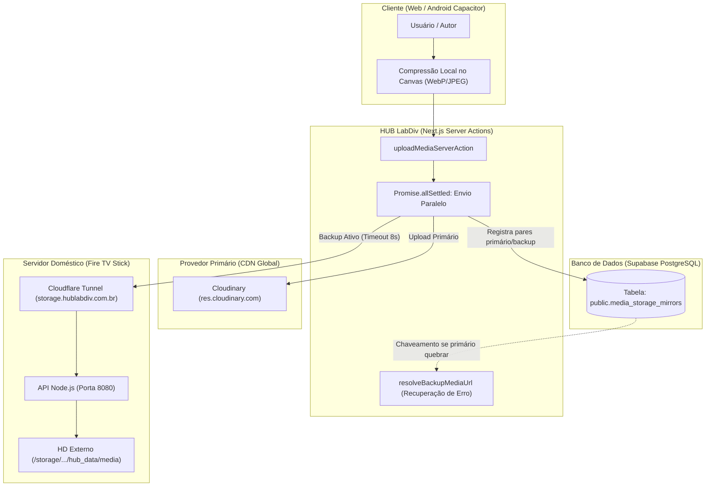

# Plano de Implementação Full-Stack: Armazenamento Híbrido Resiliente (Cloudinary CDN + Fire Stick Backup & Failover)
**Status:** AGUARDANDO APROVAÇÃO  
**Revisão:** V1.0 - Arquitetura Híbrida de Alta Disponibilidade  
**Projeto:** HUB LabDiv V3.0  
**Ambiente Host:** Linux / POSIX | Nuvem: Vercel + Supabase | Storage Local: Fire TV Stick (Termux / ARM)  

---

## 1. Visão Geral da Arquitetura Híbrida

O objetivo desta arquitetura é eliminar a vulnerabilidade de dependência exclusiva de provedores proprietários (Cloudinary), mantendo sua alta velocidade de entrega global via CDN, enquanto o servidor local **Fire TV Stick (Termux)** atua como:
1. **Espelho Físico Ativo (*Dual-Write*):** Cada nova mídia enviada ao HUB é gravada simultaneamente no HD externo do Fire Stick em background.
2. **Failover Automático Imediato:** Caso o Cloudinary atinja limites de quota, recuse o upload ou passe por instabilidade, o HUB chaveia o upload e a entrega diretamente para `https://storage.hublabdiv.com.br`.
3. **Resolução de Contingência (*Error Recovery*):** Se uma mídia do Cloudinary apresentar erro de carregamento no frontend (`onError`), a aplicação resolve automaticamente a cópia espelhada no Fire Stick sem exibir imagem quebrada.
4. **Terceiro Nível de Fallback:** Caso ambos (Cloudinary e Fire Stick) falhem, o Supabase Storage (`submissions`) permanece como rede de segurança final.



---

## 2. Diagnóstico & Auditoria do Estado Atual

| Módulo / Arquivo | Diagnóstico do Estado Atual | Impacto na Arquitetura Híbrida |
| :--- | :--- | :--- |
| [`src/app/actions/media.ts`](file:///home/stangorlini/HUB%20LabDiv/HUB-LabDiv/src/app/actions/media.ts) | Função `uploadMediaServerAction` envia unicamente para Cloudinary, com fallback no Supabase. | Não realiza escrita no Fire Stick nem registra metadados de backup. |
| [`src/app/arquivo/[id]/CommentsSection.tsx`](file:///home/stangorlini/HUB%20LabDiv/HUB-LabDiv/src/app/arquivo/[id]/CommentsSection.tsx) | Envia requisição direta `fetch` do browser para `api.cloudinary.com` via preset público. | **Vulnerabilidade de arquitetura:** escapa do pipeline central, expondo preset e ignorando o backup no Fire Stick. |
| [`next.config.ts`](file:///home/stangorlini/HUB%20LabDiv/HUB-LabDiv/next.config.ts) & [`src/lib/proxy.ts`](file:///home/stangorlini/HUB%20LabDiv/HUB-LabDiv/src/lib/proxy.ts) | Políticas CSP e `images.remotePatterns` bloqueiam origens não autorizadas fora do Cloudinary/Supabase. | Imagens servidas pelo Fire Stick seriam bloqueadas pelo navegador e no WebView Android (Capacitor). |
| [`src/lib/media-utils.ts`](file:///home/stangorlini/HUB%20LabDiv/HUB-LabDiv/src/lib/media-utils.ts) & [`src/lib/utils.ts`](file:///home/stangorlini/HUB%20LabDiv/HUB-LabDiv/src/lib/utils.ts) | Injetam transformações exclusivas do Cloudinary (`/upload/f_auto,q_auto/`). | Se aplicadas a URLs do Fire Stick, causariam erro 404. É necessário distinguir os provedores. |
| [`src/app/actions/submissions.ts`](file:///home/stangorlini/HUB%20LabDiv/HUB-LabDiv/src/app/actions/submissions.ts) | Deleta mídias apenas no Cloudinary ao excluir publicações. | Mídias salvas no Fire Stick virariam arquivos órfãos acumulando espaço no HD. |

### Performance, Segurança e Compatibilidade Web + Android
* **Proteção de Credenciais:** `STORAGE_SERVER_KEY` fica restrita estritamente ao ambiente do servidor Node.js/Next.js (`use server`).
* **Resiliência e Tolerância a Falhas:** O envio ao Fire Stick utiliza timeout estrito de **8 segundos** (`AbortSignal.timeout(8000)`). Se o Fire Stick estiver offline ou houver oscilação na banda residencial, o usuário do HUB não sofre lentidão e recebe a confirmação normalmente com o Cloudinary.
* **Android (Capacitor):** Como `storage.hublabdiv.com.br` utiliza TLS da Cloudflare Edge com certificados válidos e HTTP/2, as imagens carregam instantaneamente no app mobile sem disparar alertas de conteúdo inseguro (*Mixed Content*).

---

## 3. Modelagem de Dados & Supabase (`supabase/migrations/newsqls/`)

* **Arquivo Alvo:** [`supabase/migrations/newsqls/god-sql-mk10.sql`](file:///home/stangorlini/HUB%20LabDiv/HUB-LabDiv/supabase/migrations/newsqls/god-sql-mk10.sql)
* **Contagem de Linhas:** O arquivo possui atualmente **594 linhas**. A inclusão desta tabela e suas políticas consumirá ~45 linhas, totalizando **~639 linhas** (respeitando rigorosamente o teto de 700 linhas por arquivo).

### Código SQL a ser adicionado:
```sql
-- ==============================================================================
-- 9.9 ARMAZENAMENTO HÍBRIDO: ESPELHAMENTO CLOUDINARY <-> FIRE STICK STORAGE
-- ==============================================================================
CREATE TABLE IF NOT EXISTS public.media_storage_mirrors (
    id UUID PRIMARY KEY DEFAULT gen_random_uuid(),
    primary_url TEXT NOT NULL UNIQUE,
    primary_provider TEXT NOT NULL CHECK (primary_provider IN ('cloudinary', 'firestick', 'supabase')),
    backup_url TEXT,
    firestick_filename TEXT,
    mime_type TEXT,
    size_bytes BIGINT,
    mirror_status TEXT NOT NULL DEFAULT 'synced' CHECK (mirror_status IN ('synced', 'pending', 'primary_only')),
    uploaded_by UUID REFERENCES public.profiles(id) ON DELETE SET NULL,
    created_at TIMESTAMPTZ NOT NULL DEFAULT now()
);

CREATE INDEX IF NOT EXISTS idx_media_mirrors_primary_url ON public.media_storage_mirrors(primary_url);
CREATE INDEX IF NOT EXISTS idx_media_mirrors_status ON public.media_storage_mirrors(mirror_status);

ALTER TABLE public.media_storage_mirrors ENABLE ROW LEVEL SECURITY;

-- Leitura pública para resolução dinâmica de fallback (imagens quebradas)
DROP POLICY IF EXISTS "Leitura publica mapeamento de midia" ON public.media_storage_mirrors;
CREATE POLICY "Leitura publica mapeamento de midia"
    ON public.media_storage_mirrors FOR SELECT
    USING (true);

-- Inserção restrita a usuários autenticados (próprios envios) e Admins
DROP POLICY IF EXISTS "Usuarios registram espelho de upload" ON public.media_storage_mirrors;
CREATE POLICY "Usuarios registram espelho de upload"
    ON public.media_storage_mirrors FOR INSERT TO authenticated
    WITH CHECK (auth.uid() = uploaded_by OR public.is_admin());

-- Gestão completa restrita a Administradores (Torre de Controle)
DROP POLICY IF EXISTS "Admin gerencia espelhos de storage" ON public.media_storage_mirrors;
CREATE POLICY "Admin gerencia espelhos de storage"
    ON public.media_storage_mirrors FOR ALL TO authenticated
    USING (public.is_admin())
    WITH CHECK (public.is_admin());
```

---

## 4. Arquitetura Back-end & Tipagem (`src/types` + Server Actions)

### 4.1 Nova Tipagem: `src/types/storage.ts`
```typescript
/*!
 * Hub de Comunicação Científica Lab-Div V3.0
 * Copyright (C) 2026 João Paulo Stangorlini de Carvalho
 * Licenciado sob AGPLv3.
 */

export type StorageProvider = 'cloudinary' | 'firestick' | 'supabase';

export interface FirestickUploadResponse {
    success: boolean;
    filename: string;
    url: string;
    size: number;
    mimetype: string;
    error?: string;
}

export interface FirestickHealthStatus {
    online: boolean;
    uptime?: number;
    device?: string;
    error?: string;
}

export interface MediaMirrorRecord {
    id: string;
    primary_url: string;
    primary_provider: StorageProvider;
    backup_url: string | null;
    firestick_filename: string | null;
    mime_type: string | null;
    size_bytes: number | null;
    mirror_status: 'synced' | 'pending' | 'primary_only';
    created_at: string;
}

export interface HybridStorageOverview {
    firestickHealth: FirestickHealthStatus;
    totalTracked: number;
    syncedCount: number;
    pendingCount: number;
    primaryOnlyCount: number;
}
```
*Exportar centralmente em [`src/types/index.ts`](file:///home/stangorlini/HUB%20LabDiv/HUB-LabDiv/src/types/index.ts).*

### 4.2 Novo Módulo Utilitário do Fire Stick: `src/lib/firestick-storage.ts`
Implementação estrita de comunicação HTTP com o Termux:
- `uploadToFirestick(buffer: Buffer, originalName: string, mimeType: string)`: Realiza POST multipart em `https://storage.hublabdiv.com.br/api/upload` com timeout de 8 segundos.
- `deleteFromFirestick(filenameOrUrl: string)`: Extrai o identificador limpo e aciona `DELETE /api/media/:filename`.
- `checkFirestickHealth()`: Retorna o status online do dispositivo e seu tempo de atividade.

### 4.3 Refatoração de `src/app/actions/media.ts`
- Implementação de `uploadMediaServerAction(formData: FormData)`:
  1. Valida autenticação Supabase Auth do usuário.
  2. Validação **Zod** de payload (tamanho máximo 50MB, tipo de arquivo).
  3. Execução paralela controlada via `Promise.allSettled`:
     * Tentativa 1: Cloudinary Stream Upload.
     * Tentativa 2: Fire Stick Upload (`uploadToFirestick`).
  4. Lógica de decisão de URL principal e espelho:
     * **Cloudinary OK + Fire Stick OK:** URL primária do Cloudinary + URL de backup salva em `media_storage_mirrors` (`mirror_status = 'synced'`).
     * **Cloudinary Falhou + Fire Stick OK:** Failover imediato! Retorna a URL do Fire Stick (`primary_provider = 'firestick'`).
     * **Cloudinary OK + Fire Stick Offline:** Retorna Cloudinary sem erro ao usuário e registra `mirror_status = 'pending'`.
     * **Ambos Falharam:** Dispara 3º fallback de emergência no Supabase Storage.
- Nova Server Action: `resolveBackupMediaUrl(failedUrl: string)`:
  * Busca no Supabase se existe `backup_url` cadastrada para a URL que falhou no frontend, retornando o link direto do Fire Stick.

### 4.4 Exclusão Híbrida em `src/app/actions/submissions.ts`
Ao excluir uma postagem em `deleteSubmissionAdmin` e `deleteOwnSubmission`:
- Se a URL for do Cloudinary, chama `cloudinary.uploader.destroy`.
- Se existir espelho ou a URL for do Fire Stick, chama `deleteFromFirestick`.
- Remove o registro de espelho em `media_storage_mirrors`.

### 4.5 Nova Server Action Administrativa: `src/app/actions/storage-sync.ts`
- Ações protegidas por `is_labdiv`:
  - `getHybridStorageOverview()`: Carrega métricas e saúde do Fire Stick.
  - `syncLegacyBatchToFirestick(batchSize = 10)`: Baixa mídias antigas do Cloudinary que ainda não possuem cópia no HD do Fire Stick e as envia em lote seguro.

---

## 5. Arquitetura Front-end, UI & Temas (Lei do Full-Stack)

### 5.1 Ajustes de Entrega e Fallback Dinâmico
1. **[`src/lib/media-utils.ts`](file:///home/stangorlini/HUB%20LabDiv/HUB-LabDiv/src/lib/media-utils.ts):**
   * Em `getOptimizedUrl`: URLs contendo `storage.hublabdiv.com.br` são retornadas diretamente (sem injeção de parâmetros do Cloudinary). URLs contendo `cloudinary.com` continuam recebendo `/upload/w_{width},q_{quality},f_auto/`.
2. **[`src/app/arquivo/[id]/CommentsSection.tsx`](file:///home/stangorlini/HUB%20LabDiv/HUB-LabDiv/src/app/arquivo/[id]/CommentsSection.tsx):**
   * Substituição do `fetch` direto para `api.cloudinary.com` pelo método `uploadFileToCloudinary`, garantindo que as imagens dos comentários entrem no pipeline híbrido (com espelho físico e failover).
3. **Fallback Automático em [`src/components/media/MediaCard.tsx`](file:///home/stangorlini/HUB%20LabDiv/HUB-LabDiv/src/components/media/MediaCard.tsx):**
   * Tratamento no evento `onError` da imagem: caso o Cloudinary retorne erro HTTP, a função consulta `resolveBackupMediaUrl` e chaveia dinamicamente para o espelho do Fire Stick.

### 5.2 Novo Componente de Gestão: `src/components/admin/HybridStorageCard.tsx`
Componente Client Component posicionado na aba **Perigo** de [`src/components/admin/AdminUnifiedClient.tsx`](file:///home/stangorlini/HUB%20LabDiv/HUB-LabDiv/src/components/admin/AdminUnifiedClient.tsx):
- **Identidade Visual LabDiv & Dual-Theme:**
  - Modo Claro: fundo `bg-white border-gray-200 text-gray-900`.
  - Modo Escuro: fundo `dark:bg-[#1E1E1E] dark:border-white/10 dark:text-white` sobre base `#121212`.
  - Cores de Acento: `#0F4780` (Azul primário para botões e contadores), `#FFCC00` (Amarelo para status pendente e alertas leves), `#F14343` (Vermelho para indicação de Fire Stick offline).
  - Tipografia: títulos e números em **29LT Bukra Semi Wide Bold** (`font-bukra uppercase`), textos de apoio em **Open Sans** (`font-sans`).
- **Estados Visuais & Feedback:**
  - Skeletons animados durante a verificação de saúde do Fire Stick.
  - Toasts descritivos (`react-hot-toast`) durante os lotes de sincronização.
  - Botão de ação: **"Sincronizar Lote (10 Mídias)"** com badge de progresso.
- **Responsividade Mobile-First:** Grid responsivo em `grid-cols-1 sm:grid-cols-3` adaptado para larguras de até `375px`.

---

## 6. Plano de Execução Sequencial (Checklist)

*Todos os novos arquivos de código conterão obrigatoriamente o cabeçalho de licença **AGPLv3**.*

- [ ] **Fase 1: Infraestrutura de Dados, Tipos e Políticas de Rede**
  1. Atualizar [`supabase/migrations/newsqls/god-sql-mk10.sql`](file:///home/stangorlini/HUB%20LabDiv/HUB-LabDiv/supabase/migrations/newsqls/god-sql-mk10.sql) com a tabela `media_storage_mirrors` e RLS.
  2. Criar `src/types/storage.ts` e exportar em [`src/types/index.ts`](file:///home/stangorlini/HUB%20LabDiv/HUB-LabDiv/src/types/index.ts).
  3. Adicionar `storage.hublabdiv.com.br` em [`next.config.ts`](file:///home/stangorlini/HUB%20LabDiv/HUB-LabDiv/next.config.ts) (`remotePatterns` + `CSP`) e em [`src/lib/proxy.ts`](file:///home/stangorlini/HUB%20LabDiv/HUB-LabDiv/src/lib/proxy.ts).
  4. Adicionar preconnect em [`src/app/layout.tsx`](file:///home/stangorlini/HUB%20LabDiv/HUB-LabDiv/src/app/layout.tsx).

- [ ] **Fase 2: Motor Híbrido Dual-Write, Failover e Exclusão**
  5. Criar `src/lib/firestick-storage.ts` com as rotas de upload, deleção e healthcheck do Termux.
  6. Refatorar [`src/app/actions/media.ts`](file:///home/stangorlini/HUB%20LabDiv/HUB-LabDiv/src/app/actions/media.ts) com `Promise.allSettled`, failover imediato e `resolveBackupMediaUrl`.
  7. Atualizar [`src/app/actions/submissions.ts`](file:///home/stangorlini/HUB%20LabDiv/HUB-LabDiv/src/app/actions/submissions.ts) para exclusão sincronizada nos dois provedores.

- [ ] **Fase 3: Camada de Utilitários, Comentários e Fallback de Leitura**
  8. Atualizar [`src/lib/media-utils.ts`](file:///home/stangorlini/HUB%20LabDiv/HUB-LabDiv/src/lib/media-utils.ts) e [`src/lib/utils.ts`](file:///home/stangorlini/HUB%20LabDiv/HUB-LabDiv/src/lib/utils.ts) para suportar URLs de ambos os servidores.
  9. Migrar upload de fotos de [`src/app/arquivo/[id]/CommentsSection.tsx`](file:///home/stangorlini/HUB%20LabDiv/HUB-LabDiv/src/app/arquivo/[id]/CommentsSection.tsx) para a pipeline central com compressão.
  10. Integrar fallback dinâmico `onError` em [`src/components/media/MediaCard.tsx`](file:///home/stangorlini/HUB%20LabDiv/HUB-LabDiv/src/components/media/MediaCard.tsx).

- [ ] **Fase 4: Torre de Controle (Monitoramento + Sincronização em Lote) & Build**
  11. Criar `src/app/actions/storage-sync.ts` para monitoramento e backfill de mídias antigas.
  12. Criar `src/components/admin/HybridStorageCard.tsx` e integrá-lo em [`src/components/admin/AdminUnifiedClient.tsx`](file:///home/stangorlini/HUB%20LabDiv/HUB-LabDiv/src/components/admin/AdminUnifiedClient.tsx).
  13. Executar checagem de tipos (`tsc --noEmit`) e build de produção Next.js.

